# YMusic

<p align="center">
  
</p>

<p align="center">
  <b>自托管的音乐聚合播放与下载服务</b><br>
  一个文件跑起服务端，一个文件承载前端，不依赖任何第三方运行时库。
</p>

<p align="center">
  <a href="https://github.com/LangJi-hub/YMusic"></a>
  <a href="https://nodejs.org"></a>
  
  
  
  <a href="LICENSE"></a>
</p>

<p align="center">
  <a href="#功能特性">功能特性</a> ·
  <a href="#技术架构">架构</a> ·
  <a href="#快速开始">快速开始</a> ·
  <a href="#配置">配置</a> ·
  <a href="#api-概览">API</a> ·
  <a href="#常见问题">FAQ</a> ·
  <a href="#免责声明">免责声明</a>
</p>

---

## 这是什么

YMusic 是一个**完全自托管**的音乐服务。它把你常用的几个音乐平台的公开音源聚合到一个界面里：搜索、试听、下载、管理自己的曲库，同时提供账号体系、歌单、动态、私信、一起听等社交功能。

它最特别的地方在于工程形态：

| | |
|---|---|
| **服务端** | `server.mjs` 单文件，14,600 行，**零第三方依赖**，13 个 `import` 全部来自 `node:` 内置模块 |
| **前端** | `web/index.html` 单文件，29,600 行，**无构建步骤**，不引入任何框架 |
| **分发** | 同一份服务端代码既能 `node` 直跑，也能用 Node SEA 打成单个可执行文件 |

没有 `npm install`，没有打包器，没有 `dist` 目录。克隆下来就能跑。

> 本仓库是**脱敏后的源码副本**：用户数据、会话密钥、发信配置、部署凭据均已剔除，公网地址统一替换为 `127.0.0.1`。

## 界面预览

### 移动端（Android）

> 真机截图，1260×2720，3× 像素密度，非设计稿。

<table>
  <tr>
    <td align="center">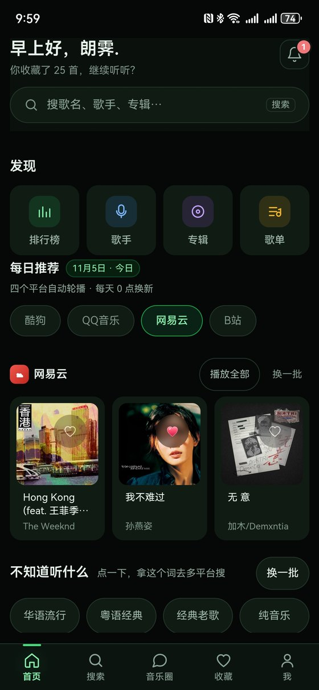<br><sub><b>首页</b><br>问候 · 发现入口 · 每日推荐</sub></td>
    <td align="center">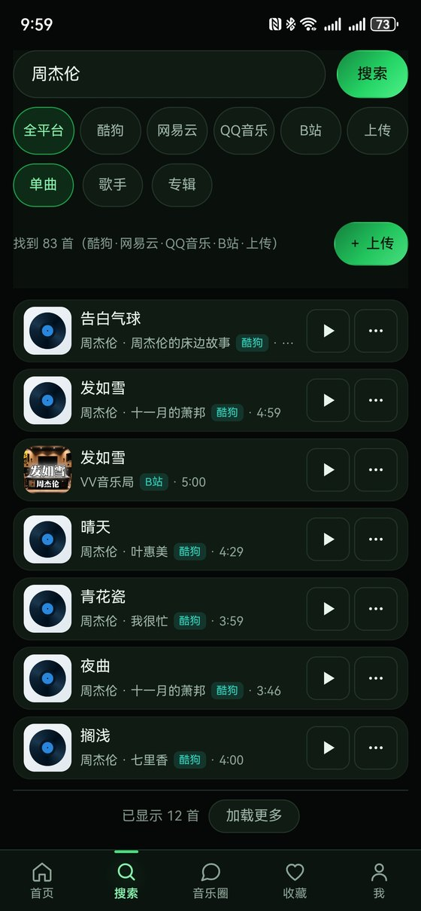<br><sub><b>聚合搜索</b><br>四平台合并去重 · 同名折叠</sub></td>
    <td align="center">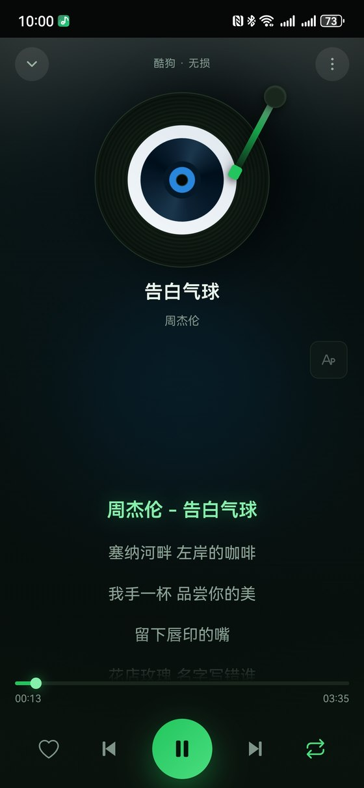<br><sub><b>播放页</b><br>黑胶唱片 · 逐行滚动歌词</sub></td>
  </tr>
  <tr>
    <td align="center">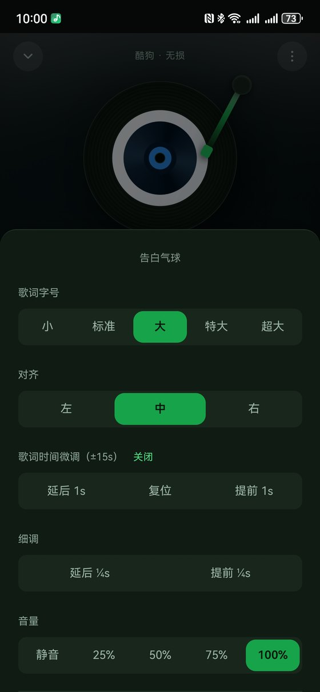<br><sub><b>播放设置</b><br>字号 · 对齐 · 歌词与音量微调</sub></td>
    <td align="center">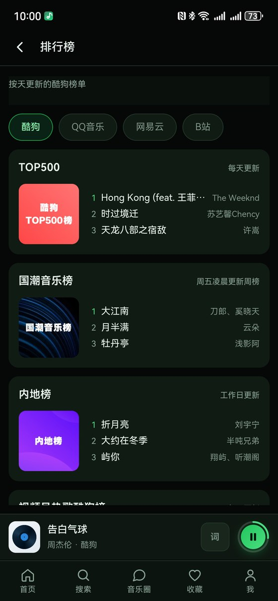<br><sub><b>排行榜</b><br>酷狗 / QQ / 网易云 / B站 榜单</sub></td>
    <td align="center"><br><sub><b>歌手</b><br>热门歌手 · 按名字检索</sub></td>
  </tr>
  <tr>
    <td align="center"><br><sub><b>歌单精选</b><br>600 个歌单 · 支持粘贴链接直开</sub></td>
    <td align="center">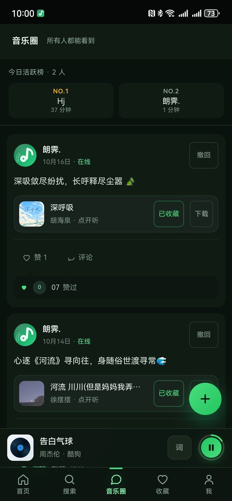<br><sub><b>音乐圈</b><br>分享动态 · 活跃榜 · 一键收藏</sub></td>
    <td align="center">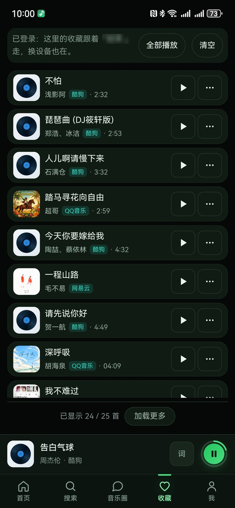<br><sub><b>我的收藏</b><br>跨设备同步 · 全平台播放</sub></td>
  </tr>
  <tr>
    <td align="center" colspan="3">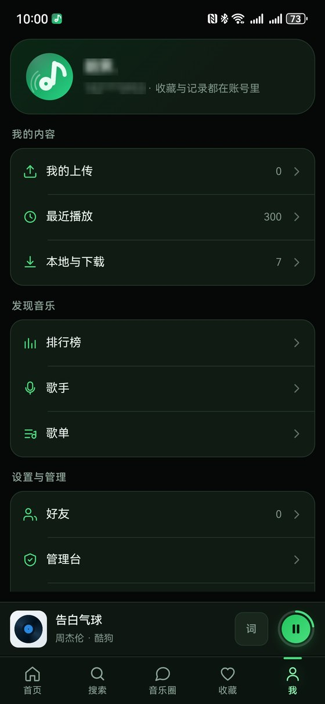<br><sub><b>个人中心</b><br>上传 · 播放记录 · 本地下载</sub></td>
  </tr>
</table>

### 桌面端（Electron）

> Windows 客户端截图，1920×1260。桌面端在移动端功能之上额外做了三件事：
> **独立桌面歌词窗**（可脱离主窗口自由摆放、始终置顶）、**多列表格视图**（标题 / 专辑 / 来源 / 时长四列对齐，便于批量浏览与下载）、**本地文件管理**（落盘路径可查、一键打开所在文件夹）。

<table>
  <tr>
    <td align="center">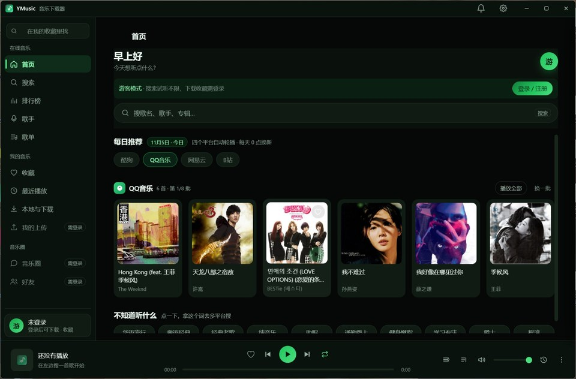<br><sub><b>首页</b> · 左侧固定导航 · 每日推荐横排</sub></td>
    <td align="center">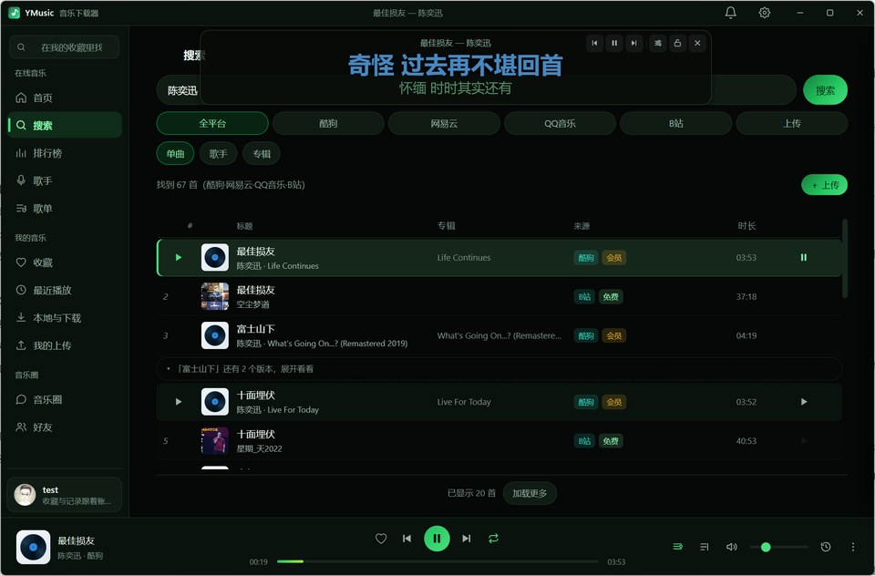<br><sub><b>桌面歌词窗</b> · 独立置顶，可与主窗口分离</sub></td>
  </tr>
  <tr>
    <td align="center">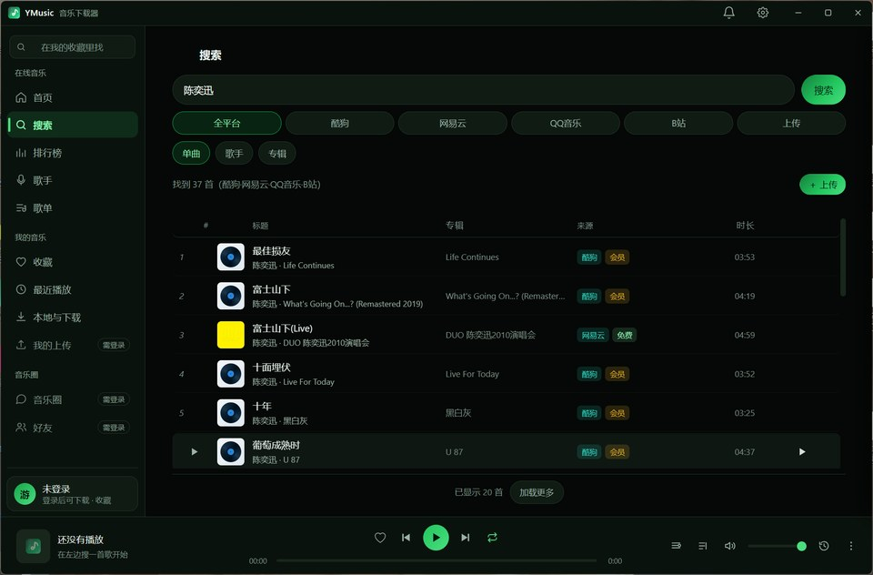<br><sub><b>搜索</b> · 四列表格 · 同名折叠可展开</sub></td>
    <td align="center">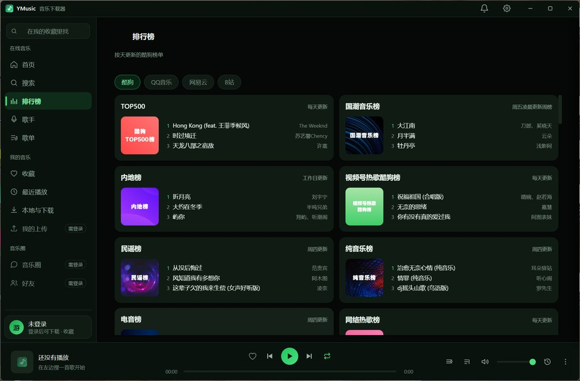<br><sub><b>排行榜</b> · 双列卡片，一屏看全榜单</sub></td>
  </tr>
  <tr>
    <td align="center">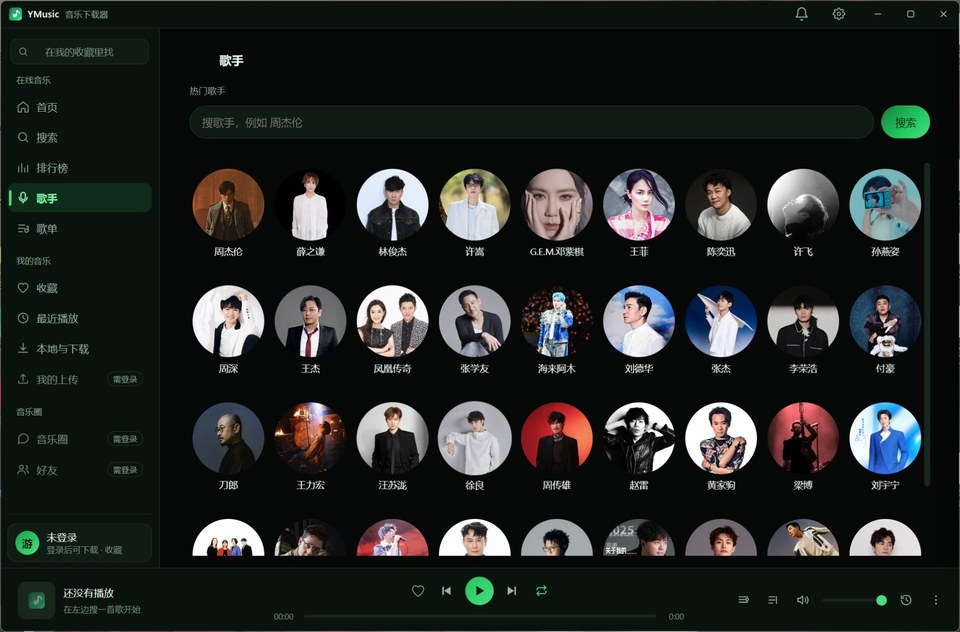<br><sub><b>歌手</b> · 宽屏九宫格，一屏更多人</sub></td>
    <td align="center">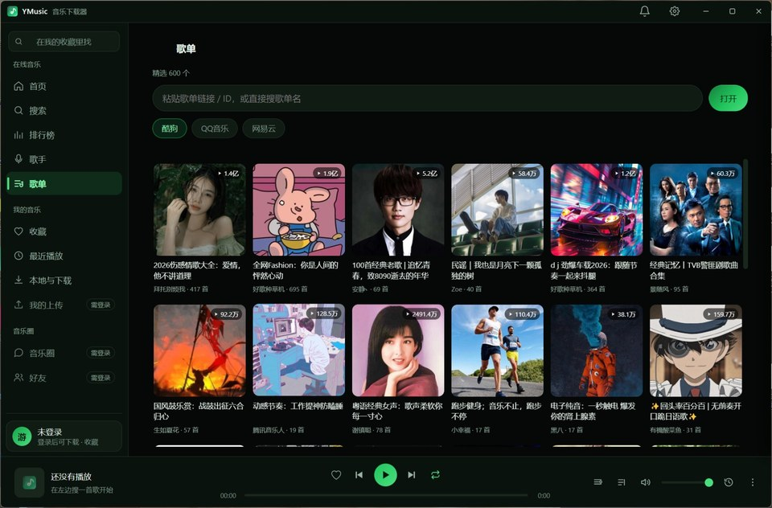<br><sub><b>歌单</b> · 六列封面 · 播放量角标</sub></td>
  </tr>
  <tr>
    <td align="center" colspan="2">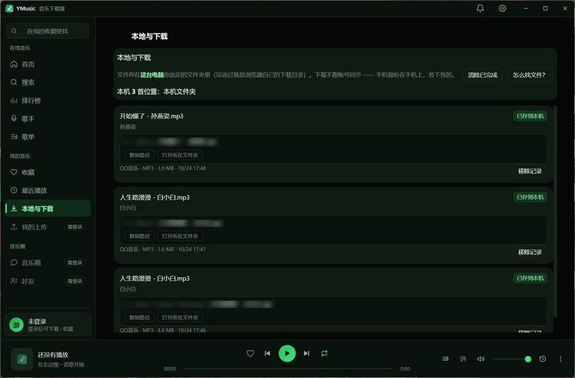<br><sub><b>本地与下载</b> · 落盘路径可查 · 打开所在文件夹</sub></td>
  </tr>
</table>

> 网页端、桌面端与 Android 端共用同一份 `web/index.html`，逻辑完全一致；桌面端与安卓端只是在外面各套了一层外壳（Electron / WebView），并按宽窄屏做了不同的列表与网格排布。

## 目录

- [界面预览](#界面预览)
  - [移动端（Android）](#移动端android)
  - [桌面端（Electron）](#桌面端electron)
- [功能特性](#功能特性)
- [技术架构](#技术架构)
- [快速开始](#快速开始)
  - [环境要求](#环境要求)
  - [本地运行](#本地运行)
  - [服务器部署](#服务器部署)
  - [打包为单文件可执行程序](#打包为单文件可执行程序)
- [配置](#配置)
- [目录结构](#目录结构)
- [API 概览](#api-概览)
- [数据与存储](#数据与存储)
- [客户端构建](#客户端构建)
- [开发约定](#开发约定)
- [常见问题](#常见问题)
- [安全说明](#安全说明)
- [免责声明](#免责声明)
- [许可证](#许可证)

## 功能特性

### 音乐检索

- **五种检索维度**：单曲、歌手（含该歌手全部作品）、专辑（含完整曲目）、榜单、歌单
- **多平台聚合**：一次搜索按平台并行取回并合并去重，结果标注来源
- **同名折叠**：同一首歌在不同平台的重复结果收拢成一行，展开可选不同来源试听
- **分页续取**：翻到本地最后一页时会真正请求下一批并追加，不是停在前 N 条

### 播放与音质

- 在线播放、进度同步、后台播放（配合 PWA）
- **音质逐档实测探测**：无损 → 320K → 128K 逐级验证可用性，而不是相信接口自称的码率
- 会员与付费曲目**如实标注**，取不到就给明确提示，不伪造、不拼接试听片段
- 歌词：逐行与逐字滚动，支持双语，缺失时如实置空
- MV 检索与播放

### 下载与曲库

- 单曲 / 批量下载，落盘目录可配置
- 下载队列与实时进度，任务可中断续传
- 个人曲库：上传、删除、时长识别、按用户隔离
- 收藏、播放历史、自建歌单

### 社交

- **账号体系**：注册、登录、找回密码、邮箱绑定，验证码走邮件
- **动态**：发布、点赞、评论、撤回
- **私信**：会话列表、未读、撤回、清空
- **朋友**：添加、查找、请求处理、移除
- **一起听**：创建房间、邀请、加入、共同选曲、进度同步

### 管理与运维

两个**互相独立**的管理台，接口面零重叠：

- **运营管理台**（`web/admin.html`，挂在主服务 `/admin`）：歌曲审核、公告发布、用户角色、白名单、上传审核、头像审核
- **账号管理台**（`admin/`，独立进程 `:8803`）：多数据源归集、账号合并去重、备份与恢复、客户端发布打包

平台账号能力（酷狗 / QQ / 网易云）通过二维码登录接入，带健康探测与到期提醒。

另有**音源守卫**（`tools/kg-guard.py`）：定时探测各音源的实际可用性，失效时告警并给出换源指引，避免用户搜到歌却播不出来。

### 客户端

- **Web**：响应式，桌面与移动共用一份代码
- **PWA**：可安装、离线缓存（`manifest.webmanifest` + `sw.js`）
- **桌面端**：Electron 壳 + 独立歌词窗口
- **移动端**：Android APK、iOS IPA、鸿蒙 HAP，由服务端 `/api/app/*` 统一分发与版本检查

## 技术架构

```
┌──────────────────────────────────────────────────────────┐
│  客户端                                                    │
│  网页端（单文件 HTML · ES5）  桌面端（Electron）             │
│  安卓 APK    iOS IPA    鸿蒙 HAP    运营管理台               │
└────────────────────────┬─────────────────────────────────┘
                         │ HTTP / JSON
┌────────────────────────▼─────────────────────────────────┐
│  server.mjs  ·  :8788                                     │
│    搜索 · 播放 · 下载 · 歌词 · 账号 · 收藏 · 歌单            │
│    动态 · 私信 · 朋友 · 一起听 · 上传 · 客户端分发             │
│    /api/admin/*  运营接口                                  │
└────────────────────────┬─────────────────────────────────┘
                         │
┌────────────────────────▼─────────────────────────────────┐
│  admin/server.mjs  ·  :8803（独立进程）                     │
│    数据源归集 · 账号合并去重 · 备份恢复 · 发布打包             │
└────────────────────────┬─────────────────────────────────┘
                         │
┌────────────────────────▼─────────────────────────────────┐
│  本地存储                    外部音源                       │
│  data/*.json  结构化数据      酷狗 · QQ音乐 · 网易云          │
│  Downloads/   音频落盘        B站 · 抖音                    │
│  geo/         离线 IP 库                                    │
└──────────────────────────────────────────────────────────┘
```

### 为什么是单文件

这不是为了炫技，是被分发场景逼出来的选择：

1. **部署即复制**。服务器上只有一个 `.mjs`，升级就是覆盖文件 + 重启，没有依赖树漂移，不会出现「本地能跑线上报错」。
2. **能打成 exe**。通过 `node:sea` 探测运行形态，打包态下配置与日志落到可执行文件所在目录，前端资源磁盘优先、找不到则读内嵌资产。同一份源码同时是「服务端」和「桌面程序后端」。
3. **审计成本低**。14,600 行在一个文件里，谁改了什么一目了然。

### 为什么前端守 ES5

`web/index.html` 刻意不使用 `let` / `const` / 箭头函数 / 模板字符串 / 解构 / `class` / 可选链，只用 `var` + `function`。原因是它要同时跑在：

- 老旧的车机与电视浏览器
- 系统 WebView 版本偏低的安卓机
- Electron 壳里被注入的受限环境

代价是可读性，收益是「任何能打开网页的设备都能用」。

## 快速开始

### 环境要求

| 项 | 要求 |
|---|---|
| Node.js | **≥ 22**（用到 `node:sea`、内置 `fetch`） |
| 操作系统 | Linux / macOS / Windows |
| 磁盘 | 视曲库规模而定，音频落盘占主要空间 |
| 内存 | 常驻约 150 MB |

### 本地运行

```bash
git clone https://github.com/LangJi-hub/YMusic.git
cd YMusic
node server.mjs
```

打开 <http://127.0.0.1:8788>。

首次启动会自动创建 `data/` 目录并初始化空的数据文件，无需手动准备。

### 服务器部署

```bash
bash deploy/install.sh /tmp/ymusic-cloud.tar.gz
```

脚本会完成：

1. 安装 Node.js 22（NodeSource 源）
2. 创建专用运行用户 `ymusic` 与目录 `/opt/ymusic`
3. 解压工程（不含 `node_modules`，因为服务端零依赖）
4. 写入 Linux 版 `config.json`
5. 探测本机公网 IP 并写入 `public-url.txt`（客户端打包时读取）
6. 安装 systemd 服务并拉起 `8788` / `8803`

脚本**可重复执行**，已完成的步骤会自动跳过。

配套文件：

| 文件 | 用途 |
|---|---|
| `deploy/ymusic.service` | 主服务 systemd 单元 |
| `deploy/ymusic-admin.service` | 账号管理台 systemd 单元 |
| `deploy/logrotate-ymusic.conf` | 日志轮转策略 |

### 打包为单文件可执行程序

```bash
node --experimental-sea-config sea-config.json
# 按 Node 官方 SEA 流程注入 blob 后得到单个可执行文件
```

运行态通过 `nodeRequire('node:sea')` 同步探测（**不用顶层 await**，SEA 的 ESM 引导对顶层 await 支持不稳）。

> 打包产物中 `__dirname` 指向虚拟路径，所有可写路径必须走 `APP_DIR`（`process.execPath` 的目录），不能直接用 `__dirname`。

## 配置

### config.json

首次启动会自动生成。需要手动指定时，从示例复制一份：

```bash
cp config.example.json config.json
```

```json
{
  "downloadDir": "/opt/ymusic/Downloads/YMusic",
  "concurrency": 4
}
```

> `config.json` 是**运行期文件**，已被 gitignore。仓库里只保留 `config.example.json`。

| 字段 | 类型 | 说明 |
|---|---|---|
| `downloadDir` | string | 下载落盘根目录，需可写 |
| `concurrency` | number | 并发下载数，建议 3–6 |

### 环境变量

| 变量 | 说明 |
|---|---|
| `YM_APP_DIR` | 覆盖应用根目录（打包态或容器内常用） |

### 运行时文件

| 文件 | 说明 |
|---|---|
| `public-url.txt` | 对外访问地址，客户端打包与升级检查时读取 |
| `runtime.json` | 运行期状态（端口、PID、实际数据目录），**不要提交** |

## 目录结构

```
.
├── server.mjs                 主服务 · 零依赖单文件 · :8788
├── config.example.json        配置示例（复制为 config.json 使用）
├── package.json               仅声明 playwright（桌面端自动化用）
├── public-url.txt             对外地址
│
├── web/                       前端
│   ├── index.html             主界面 · 单文件 · ES5
│   ├── admin.html             运营管理台
│   ├── install.html           客户端安装引导
│   ├── kg.html                酷狗专用页
│   ├── desktop/lyric.html     桌面端独立歌词窗
│   ├── sw.js                  Service Worker
│   ├── manifest.webmanifest   PWA 清单
│   ├── icons/                 应用图标（含 maskable）
│   └── logo*.svg              标识
│
├── admin/                     账号管理台（独立进程）
│   ├── server.mjs             :8803 后端
│   ├── index.html             界面
│   ├── sea-main.cjs           SEA 打包入口
│   └── sources.json           数据源配置
│
├── android-admin/             Android 管理端发布信息
├── bootstrap/                 客户端引导页与地址下发
├── deploy/                    部署与运维脚本
├── tools/
│   └── kg-guard.py            音源可用性守卫（定时探测、失效告警、自动换源）
├── geo/                       ip2region 离线 IP 库
│
├── 一键打包.py                 客户端打包脚本（Electron 壳 / Android APK）
├── 打包与分发说明.md            打包、签名与分发的操作说明
│
├── docs/                      文档
│   ├── API.md                 152 个接口清单
│   ├── ARCHITECTURE.md        设计决策说明
│   └── screenshots/           真机截图（README 引用）
│
└── data/                      ← 运行时生成，已 gitignore
    ├── users.json             账号
    ├── sessions.json          会话
    ├── secrets.json           发信配置与票据密钥
    └── ...                    收藏 / 歌单 / 动态 / 私信 / 缓存
```

**`data/` 绝对不要提交或外传**——里面是明文用户数据与密钥。

## API 概览

服务端共 **152 个端点**，全部为 JSON over HTTP。完整清单见 [`docs/API.md`](docs/API.md)。

| 分组 | 数量 | 职责 |
|---|---:|---|
| `admin` | 38 | 运营管理：审核、公告、角色、白名单、平台账号与健康探测 |
| `app` | 34 | 客户端分发与版本：APK / EXE / IPA / HAP、更新检查 |
| `auth` | 17 | 注册、登录、验证码、找回、绑定邮箱、SMTP 配置 |
| `listen` | 9 | 一起听房间：创建、邀请、加入、选曲、同步 |
| `chat` | 8 | 私信：会话、发送、撤回、已读、清空 |
| `music` | 7 | 曲库：上传、删除、列表、文件、时长 |
| `moment` | 6 | 动态：发布、列表、点赞、评论、撤回 |
| `friend` | 6 | 好友：添加、查找、请求、处理、移除 |
| `search` | 4 | 单曲 / 歌手 / 专辑 / 歌单检索 |
| `task` | 4 | 下载任务队列 |
| `share` | 4 | 分享：发送、列表、读取、删除 |
| 其他 | 25 | 播放地址解析、歌词、代理、图片、榜单、配置、同步 |

典型调用：

```bash
# 健康检查
curl http://127.0.0.1:8788/api/ping

# 搜索（src=all 表示全平台）
curl "http://127.0.0.1:8788/api/search?q=晴天&src=all&page=1&size=30"

# 取播放地址
curl "http://127.0.0.1:8788/api/resolve?..."

# 下载进度
curl "http://127.0.0.1:8788/api/dl/progress"
```

## 数据与存储

存储刻意选择了 **JSON 文件 + 原子写**，而不是数据库：

- 部署零依赖，不需要额外进程
- 单机自托管场景下数据量在几十 MB 量级，JSON 完全够用
- 备份 = 复制 `data/` 目录，恢复 = 放回去

写入统一走 `writeJSON()` 做**原子替换**（先写临时文件再 rename），避免进程被杀时留下半截文件。

主要数据文件：

| 文件 | 内容 |
|---|---|
| `users.json` | 账号、密码哈希（scrypt + 随机盐）、角色、绑定信息 |
| `sessions.json` | 会话令牌（90 天 TTL） |
| `secrets.json` | SMTP 授权码、票据密钥、各平台登录凭证 |
| `social.json` | 关注、好友、分享 |
| `moments.json` / `moment-msg.json` | 动态与评论 |
| `listen.json` | 一起听房间状态 |
| `uploads.json` / `avatars.json` | 上传与头像元数据 |
| `*-health.json` | 各平台凭证健康状态 |
| `daily-cache.json` | 每日推荐缓存 |

## 客户端构建

服务端通过 `/api/app/*` 提供统一的版本检查与文件分发：

| 端点 | 产物 |
|---|---|
| `/api/app/apk` · `/api/app/file` | Android |
| `/api/app/exe` | Windows 桌面端 |
| `/api/app/ipa` · `/api/app/ios` | iOS |
| `/api/app/hap` | 鸿蒙 |
| `/api/app/admin-apk` | 管理端 APK |
| `/api/app/version` · `/api/app/update-now` | 版本检查与强制更新 |

发布信息存放在 `data/apk-release.json`（版本号、文件名、大小、MD5、强制更新标记）。

## 开发约定

改这个项目之前，有几条不能破的线：

1. **`web/index.html` 必须守 ES5**。禁用 `let` / `const` / 箭头函数 / 模板字符串 / 解构 / `class` / 可选链。
2. **`server.mjs` 不允许引入第三方依赖**。SEA 打包只注入这一个文件，`import` 任何本地模块或 npm 包都会在打包态崩掉。
3. **可写路径必须走 `APP_DIR`**，不要用 `__dirname`——打包态下它是虚拟路径。
4. **改前端 JS 后要验证语法**。单文件体量大，编辑时容易吃掉相邻分支的花括号，结果是整个脚本块不执行、页面全黑，而静态检查看不出来。
5. **列表类新增数据源要三处同时改**：容器选择器、上下文目标映射、以及该分支的数据源指向。漏掉第三处会静默播错歌。

## 常见问题

<details>
<summary><b>启动后页面空白，怎么排查？</b></summary>

大概率是前端脚本有语法错误导致整块不执行。打开控制台看第一条报错，通常是编辑时破坏了相邻分支的括号配对。
</details>

<details>
<summary><b>搜索返回条数比 size 多很多？</b></summary>

`size` 的语义是**每个平台取多少**，不是总数。多平台合并去重后自然更多。
</details>

<details>
<summary><b>会员曲目只能放 30 秒？</b></summary>

需要该平台的有效登录凭证。用管理台的二维码登录接入账号后，音质与时长会按账号权限提升。
</details>

<details>
<summary><b>能多用户同时用吗？</b></summary>

可以。账号体系按用户隔离曲库、收藏与历史。但这是**单机自托管**定位，不建议当公网多租户服务跑。
</details>

<details>
<summary><b>怎么备份？</b></summary>

停服务，复制 `data/` 与 `Downloads/` 两个目录即可。恢复时放回原位。
</details>

<details>
<summary><b>为什么不用数据库？</b></summary>

见[数据与存储](#数据与存储)。单机自托管场景下，JSON + 原子写的运维成本远低于维护一个数据库进程。
</details>

## 安全说明

这不是一个面向公网多租户设计的系统，自建自用请务必注意：

- **首次部署后立刻改掉管理员授权码**。源码里的 `DEFAULT_ADMIN_CODE` 是占位值，不去改等于把提权入口留给所有人。
- **不要把 `data/` 暴露到 Web 可访问目录**，里面有明文发信配置与平台凭证。
- **建议前置反向代理加 HTTPS**，主服务本身不处理证书。
- **建议只监听回环**，由 Nginx 反代对外，不要像某些部署那样让应用端口直接面向公网。
- 平台账号凭证以明文存放在 `secrets.json`，请按密钥对待。

漏洞报告请见 [SECURITY.md](SECURITY.md)。

## 免责声明

本项目**仅供个人学习与技术研究使用**。

- 所有音源均来自各平台**对外公开提供**的接口，本项目不做签名破解、不做会员绕过、不拼接试听片段。
- 不存储、不分发任何音频文件本体，所有下载行为由使用者自行发起并承担后果。
- 请在使用前确认你的行为符合当地法律法规及各平台服务条款。
- 因使用本项目产生的任何法律与版权纠纷，由使用者自行承担，作者不承担任何责任。

**如果你喜欢某个平台的内容，请支持正版。**

## 许可证

[MIT](LICENSE) © 2026 LangJi-hub

## 致谢

- [ip2region](https://github.com/lionsoul2014/ip2region) — 离线 IP 归属地库，见 [LICENSE-ip2region](LICENSE-ip2region)
- 各音乐平台对外提供的公开接口
- 所有让这个项目变得更好的使用者
